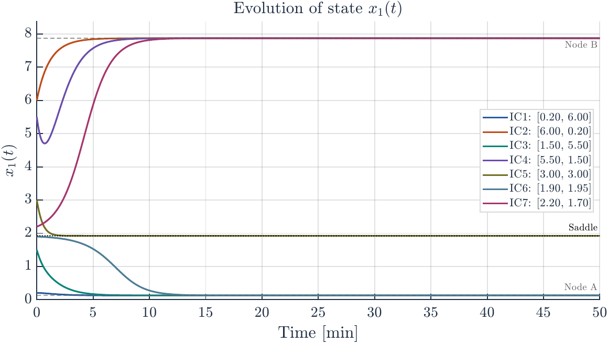

# Analysis and Control of a Genetic Toggle Switch

A Nonlinear Dynamics and Control project on a two-state bistable model with competition for shared expression resources. The project characterizes the open-loop dynamics and compares classical controllers with reinforcement learning in MATLAB and Simulink.

[Technical report](Report_Trenti.pdf)



## Project contribution

- Computed and classified equilibria using the Jacobian, checked local stability with quadratic Lyapunov functions, and simulated free evolution from multiple initial conditions.
- Compared PI, input-output feedback linearization, and sliding mode control in Simulink, together with tabular Q-learning and deep Q-networks in MATLAB.
- Evaluated regulation around the unstable equilibrium. The report compares tracking error, control effort, and response to disturbances across the simulated cases.

## Results

The open-loop script finds **two stable nodes and one saddle** for the balanced case and **one stable node** for the asymmetric case used in the report. The plot above shows how the balanced trajectories depend on their starting points.

## Run the project

Tested with MATLAB R2026a. The equilibrium and Lyapunov scripts use Optimization Toolbox and Control System Toolbox, respectively. The three classical controllers use Simulink. The DQN scripts use Reinforcement Learning Toolbox and Deep Learning Toolbox.

Run the command for the analysis or controller you want from the repository root.

```matlab
run('Open-loop analysis/equilibria.m')
run('Open-loop analysis/Lyapunov1.m')
run('Open-loop analysis/free_evolution_plot.m')

run('Controller/PI_controller/Plot_results.m')
run('Controller/IO_FBL/Plot_results_sim.m')
run('Controller/IO_FBL/Plot_int_dyn.m')
run('Controller/SMC/Plot_SMC.m')

run('Controller/Tabular_Q_learning/tql_toggle.m')
run('Controller/Deep_Q_network/training.m')
run('Controller/Deep_Q_network/Disturb_training.m')
```

The analysis and Simulink scripts print results or export PDF plots. Tabular Q-learning saves checkpoints and a final Q-table in its `outputs/` folder. The [original Q-table](Controller/Tabular_Q_learning/qtable_final_20251220_213934.mat) is included.

## Verification

- Ran the open-loop scripts and all three Simulink controllers using their saved configurations.
- Completed the 6,000-episode tabular run and checked all six checkpoints and the saved Q-table. The run reported 14% success over its final 100 training episodes. Tested training and rollout for both DQN variants with two short episodes each.
- The archived disturbance DQN script uses a 1,500-episode limit. The learning curve in the report extends to 3,000 episodes. The MATCONT continuation plots are provided in the report. Reproducing those plots requires rebuilding the continuation setup.
